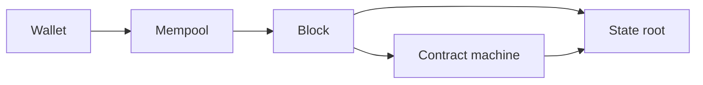

# Timechain HQ

The token is Timecoin. The ticker is TIC.

Original repository: <https://github.com/9lordisgod/Timecoin>

| Repository | What it runs |
| --- | --- |
| [Timecoin](https://github.com/9lordisgod/Timecoin) | Layer-1 testnet node |
| [Timechain-HQ/Timecoin](https://github.com/Timechain-HQ/Timecoin) | Organization copy of that node |
| [book](https://github.com/Timechain-HQ/book) | Issuance schedule, note bytes, and block rules |
| [wallet](https://github.com/Timechain-HQ/wallet) | View keys, payments, and sweeps |
| [contracts](https://github.com/Timechain-HQ/contracts) | Contract machine and the vault |
| [privacy](https://github.com/Timechain-HQ/privacy) | View keys, memos, and the public TIC amounts |
| [post-quantum](https://github.com/Timechain-HQ/post-quantum) | Day-one ML-DSA-44 and ML-KEM-768 rules |

Network `timecoin-testnet`. 1 TIC = 10^8 base units. Each block mints 50 TIC. Notes use ML-DSA-44 and ML-KEM-768. Amounts are public so a node can reject inflation. This is a testnet. There is no mainnet and no gossip network.
