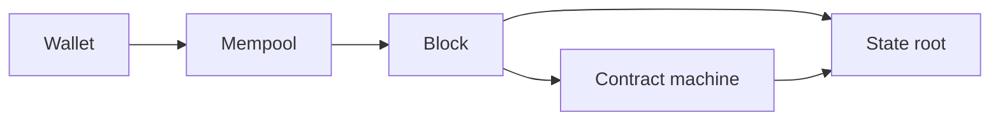

<h1 align="center">Timechain HQ</h1>

  <strong>Timecoin</strong> · ticker <strong>TIC</strong> 
  Post-quantum layer-1 <em>testnet</em> · day-one ML-DSA-44 &amp; ML-KEM-768 
  Amounts public · view keys private · <strong>not mainnet</strong>

  <a href="https://github.com/Timechain-HQ/roadmap">Roadmap</a> ·
  <a href="https://github.com/Timechain-HQ/Timecoin">Node</a>

---

## Repositories

| Repository | What it is |
| --- | --- |
| [Timecoin](https://github.com/Timechain-HQ/Timecoin) | Layer-1 testnet node |
| [book](https://github.com/Timechain-HQ/book) | Protocol book — state, notes, blocks, contracts |
| [wallet](https://github.com/Timechain-HQ/wallet) | View keys, payments, sweeps |
| [contracts](https://github.com/Timechain-HQ/contracts) | Gas-metered machine and vault |
| [privacy](https://github.com/Timechain-HQ/privacy) | What the block hides and what it publishes |
| [post-quantum](https://github.com/Timechain-HQ/post-quantum) | Day-one ML-DSA-44 and ML-KEM-768 rules |
| [roadmap](https://github.com/Timechain-HQ/roadmap) | Public testnet path (not a launch promise) |

Original personal node: [9lordisgod/Timecoin](https://github.com/9lordisgod/Timecoin)

## Network facts

| | |
| --- | --- |
| Network | `timecoin-testnet` |
| Chain id | `timecoin-testnet-1` |
| Unit | 1 TIC = 10⁸ base units |
| Block reward | 50 TIC · no premine |
| Slot target | 600 seconds |
| Spend / block sig | ML-DSA-44 (FIPS 204) |
| Note seal | ML-KEM-768 (FIPS 203) |

Genesis is domain-separated from any later network. There is no gossip network and no audit claim yet. See the [roadmap](https://github.com/Timechain-HQ/roadmap) for what comes next — and what is deliberately not promised.
